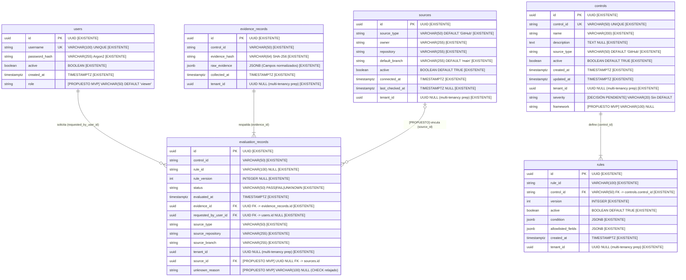

# Especificación de Modelo de Datos Lógico — SECURECODE

**Spec:** `.kiro/specs/data-model/data-model.md`  
**Fase:** SDD — SPECIFICATION (Modelo Lógico de Datos Actualizado)  
**Fecha:** 2026-10-07  
**Estado:** PROPUESTO (Solo Documentación y Propuesta — No altera código ni migraciones)  

---

## 1. Contexto y Objetivos

SECURECODE es una plataforma B2B SaaS de automatización de cumplimiento de seguridad (GRC). Su motor determinista evalúa infraestructura de código (comenzando con GitHub Branch Protection: `GH-001` y `GH-002`) bajo una semántica formal tri-estado: `PASS`, `FAIL` y `UNKNOWN` (donde `UNKNOWN` representa evidencia insuficiente o falta de observabilidad, nunca un error ni un fallo).

Este documento formaliza el **Modelo de Datos Lógico** incorporando las decisiones de diseño adoptadas, el lenguaje riguroso de **verificación de integridad** y la auditoría exhaustiva de la persistencia real. En todo el documento se utiliza estrictamente el nombre real de la tabla: **`evaluation_records`**.

---

## 2. Diagrama Entidad-Relación Lógico (Mermaid ER)

El siguiente diagrama utiliza notación *Crow's Foot*. Se distingue explícitamente entre:
- **`[EXISTENTE]`**: Columnas y relaciones presentes hoy en PostgreSQL y migraciones Alembic (`ae4b780826f2`, `1bfdcaee6d14`, `4d932f877ae7`, `7409c81f5bf7`).
- **`[PROPUESTO]`**: Nuevas columnas o restricciones aprobadas.



---

## 3. Decisiones de Diseño y Coherencia Lógica

### 3.1 Causa de Estado `UNKNOWN` (`unknown_reason`)
- **Implementación:** Columna formal en `evaluation_records`.
- **Vocabulario Cerrado:**
  Incluye explícitamente `'INCOMPLETE_EVIDENCE'` para telemetría con atributos nulos (`None`):
  - `'INCOMPLETE_EVIDENCE'`
  - `'INSUFFICIENT_TOKEN_SCOPES'`
  - `'RESOURCE_NOT_FOUND'`
  - `'RATE_LIMITED'`
  - `'SCHEMA_MISMATCH'`
  - `'UNAUTHENTICATED'`
  - `'PUBLIC_ENDPOINT_RESTRICTION'`
- **CHECK de Coherencia Relajado:**
  ```sql
  CONSTRAINT chk_eval_unknown_reason_coherence CHECK (
      status = 'UNKNOWN' OR unknown_reason IS NULL
  )
  ```
  *Justificación:* La regla bidireccional estricta habría roto inmediatamente todas las filas históricas en la base de datos (donde `unknown_reason` es NULL) y habría provocado caídas con `IntegrityError` en los endpoints actuales (`evaluate_and_store_*`), los cuales aún no inyectan dicha causa. La versión relajada asegura que un `PASS` o `FAIL` nunca posea una causa de `UNKNOWN`, preservando compatibilidad regresiva.

### 3.2 Remediación ante `FAIL` Delegada al Frontend
- La remediación técnica y enlaces a GitHub se administran íntegramente en la capa cliente (frontend), eliminando la columna `remediation_guidance` del esquema relacional.

### 3.3 Relación Dual `source_id` + Texto Histórico
- En `evaluation_records` se incorpora `source_id UUID NULL REFERENCES sources(id)`.
- Se preservan de forma redundante `source_repository VARCHAR(255)` y `source_branch VARCHAR(255)` para auditoría forense histórica inalterable.

### 3.4 Regla Activa Única Ajustada por `rule_id`
- Cada regla posee su propio identificador funcional de negocio en la carpeta `rules/` (ej. regla `GH-001-RULE` para el control `GH-001`, y `GH-002-RULE` para el control `GH-002`). Un control puede tener asociadas reglas adicionales en el futuro; por lo tanto, el índice único parcial no restringe por `(control_id)`, sino estrictamente por **`(rule_id)`**:
  ```sql
  CREATE UNIQUE INDEX uq_rules_one_active_per_rule ON rules (rule_id) WHERE active = TRUE;
  ```
- **Por qué no se usa `(rule_id, tenant_id)` en el MVP:** En SQL estándar, PostgreSQL y SQLite, `NULL != NULL`. Un índice sobre `(rule_id, tenant_id)` no evitaría colisiones de reglas globales duplicadas cuando `tenant_id` es `NULL`. En el MVP, al ser todas las reglas globales (`tenant_id = NULL`), `(rule_id) WHERE active = TRUE` garantiza unicidad real.

### 3.5 Fuentes: Reemplazo de UNIQUE por Índices Parciales
- La restricción `UNIQUE (source_type, owner, repository, tenant_id)` existente en las migraciones queda **reemplazada por dos índices únicos parciales** para resolver el comportamiento de `NULL` en SQL:
  - Globales (MVP): `UNIQUE INDEX ON sources (source_type, owner, repository) WHERE tenant_id IS NULL`
  - Tenants (Futuro): `UNIQUE INDEX ON sources (source_type, owner, repository, tenant_id) WHERE tenant_id IS NOT NULL`
- En SQLAlchemy (`models.py`) deben declararse explícitamente con `postgresql_where=text("tenant_id IS NULL")` y `sqlite_where=text("tenant_id IS NULL")` (e ídem para `IS NOT NULL`) para compatibilidad tanto con PostgreSQL en producción como con SQLite en el test suite.

---

## 4. Evidencia: Alcance del Hash, `raw_evidence` y Adopción de Alternativa B

### 4.1 Alcance del Hash, Naturaleza de `raw_evidence` y HU-06
- **Hash Canónico:** El cálculo de hash SHA-256 cubre exclusivamente los **campos normalizados** (`control`, `dismiss_stale_reviews`, `required_review_approvals` en GH-001; `control`, `default_branch`, `protection_enabled` en GH-002). **No identifica el repositorio, la rama ni el timestamp (`collected_at`)**.
- **Contenido Real de `raw_evidence`:** En [`repository.py`](file:///c:/Users/achej/Documents/SecureCode/src/securecode/adapters/postgres/repository.py), `raw_evidence` almacena el diccionario de los **campos normalizados ya extraídos**, no el payload HTTP crudo devuelto por GitHub.
- **Estado de HU-06 (Visor de JSON crudo de GitHub):** Clasificada como **NO SATISFECHA con el esquema actual**. Se documentan dos opciones:
  - *Opción 1 (MVP):* Reescribir el Escenario 2 de HU-06 para presentar la evidencia estructurada normalizada en formato JSON.
  - *Opción 2 (Evolución Futura):* Persistir el payload HTTP crudo original de GitHub, con modificación de adaptadores y auditoría exhaustiva de la política de cero secretos para evitar almacenar credenciales.

### 4.2 Desacoplamiento de Unicidad (Alternativa B: Sin Deduplicar)
*(Estado: **Pendiente de confirmar con Jonathann**)*
- **Diagnóstico:** Dos repositorios con configuraciones de ramas idénticas generan exactamente el mismo hash. El índice `UNIQUE (control_id, evidence_hash, tenant_id)` aborta la ejecución en la segunda evaluación con `IntegrityError` porque `evaluate_and_store_*` ejecuta un `INSERT` incondicional con `uuid4()`.
- **Decisión Adoptada:** Se suelta la unicidad en `evidence_records` y se deja un índice ordinario no único en `(control_id, evidence_hash)`:
  ```sql
  DROP INDEX IF EXISTS uq_evidence_control_hash;
  CREATE INDEX idx_evidence_control_hash ON evidence_records (control_id, evidence_hash);
  ```
- **Impacto:** Permite que cada evaluación preserve su propio `collected_at` exacto sin colisiones. Requiere actualizar `models.py` (quitar `unique=True`) y actualizar el **Test 3 de TASK-05** (`test_unique_evidence_hash_per_tenant`), el cual esperaba un `IntegrityError` al duplicar.

---

## 5. Mapeos Normativos
- Las referencias al marco de trabajo `PR.IP-1` quedan registradas como:
  > **`PR.IP-1` (pendiente de verificar contra NIST CSWP.29)**.
